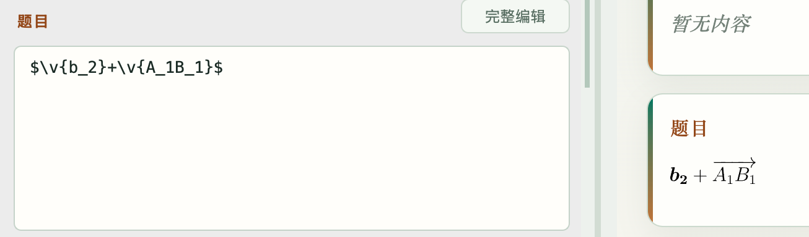
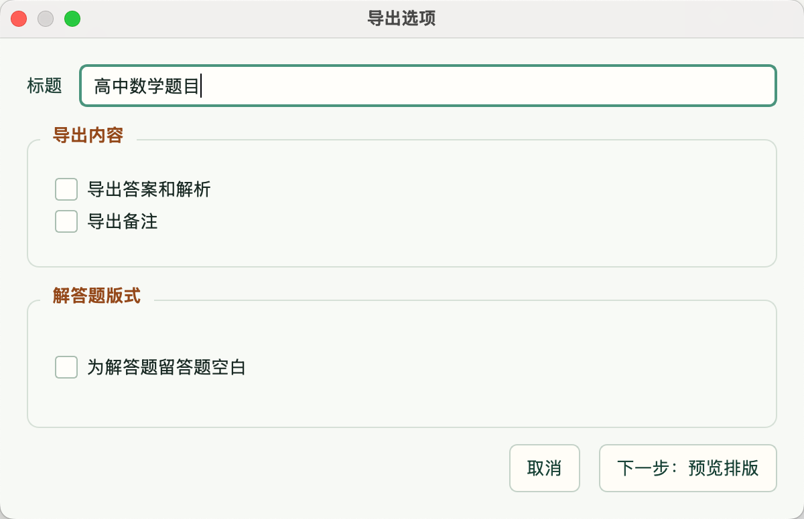

# ProblemManager说明书

分为创建题目、导出题目两部分来介绍。

## 1. 创建题目

**用法**：

在【文件】菜单中点击【新建题目】，进入编辑界面。按照实际需要填写各项内容即可。左侧是编辑区，各部分均支持latex公式；右侧是预览区，会将latex公式实时渲染。除题型和难度外，每一项都可以留空，不影响题目创建。

**具体说明**：
- 关于难度：难度分为10档，以半颗星为一档
- 关于选择题的选项：选择题的选项按实际需要填写即可，留空的选项将不会出现在最终呈现的题目中
- **关于编辑**：
  - 可以直接在左侧编辑栏的编辑框中编辑。如果内容较长，也可以点击【完整编辑】在完整的弹出窗口中编辑。弹出窗口中提供了更多易用工具，以及latex速查表。
  - **按住Ctrl键点击右侧预览部分的任意位置，即可在左侧编辑面板中让光标跳转到相应位置。**
  - 语法糖：
    - 支持用`\v{}`来表示向量：如果填入的是单个字母，就会被转为$\boldsymbol{a}$的形式；如果填入两个字母，就会被转为$\overrightarrow{AB}$的形式。
    
    - 填空题可以用`@`符号来表示横线。
- 关于配图：题目本身的配图放在最底端的【题目配图】栏，支持拖入、从剪贴板粘贴、从文件上传（“软件内画图”按钮暂时不具有可用性）。解析中的配图，直接在编辑解析内容时粘贴即可，会插入到编辑光标处。两种配图均支持插入多张
  - 如果已有手写版的解答过程，不想花时间将其录入，不妨直接将手写版的图片粘贴到解析栏中！或利用AI工具将手写稿识别成文字+latex公式！
- 知识点标签和方法标签均可多选。知识点标签是固定的选项，从人教A版教材目录中提取而来，在主界面中支持按知识点排序。方法标签可以自定义，因此可以打造成自己的独特标签系统，而不必拘泥于现有的标签思路。两类标签均支持用来检索、筛选题目。

## 2. 导出题目

### 2.1 试题篮

导出题目的操作单位是“试题篮”。右上角【管理试题篮】按钮可以打开管理界面，除了默认试题篮之外，可以新建若干有名字的试题篮。

在【管理试题篮】左侧的下拉框选择当前要操作的试题篮后，题目列表中的题目即可直接勾选加入该试题篮。同一个题目可以存在于多个试题篮中。

### 2.2 导出

为试题篮添加了足够的题目之后，可以点击右上角【导出当前篮子】进行导出。根据需要完成设置后，点击下一步即可。**这里的【标题】是导出的试卷顶部的标题文字，而非文件名。**

预览排版界面中，可以完成如下调整操作：
1. 调整题目顺序。在左侧列表中拖拽即可。
2. 调整题目留空大小。根据解答题预计需要的空间设置即可。
3. 调整题图大小。

在右侧预览视图中点击任意题目可以在左侧列表自动跳转到该题目。
